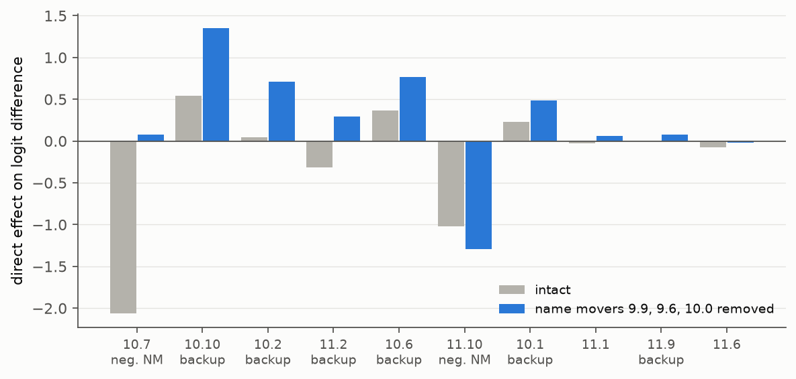
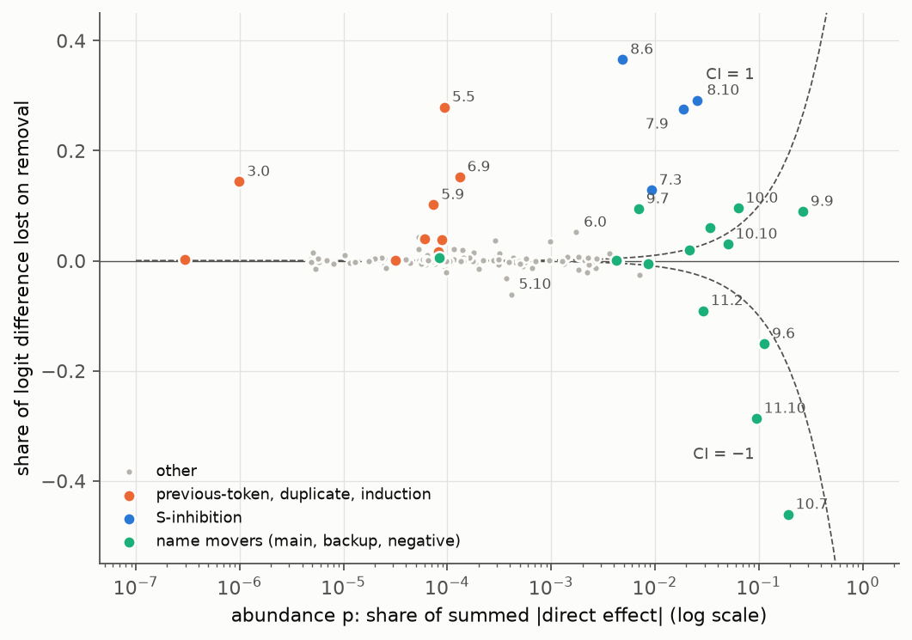
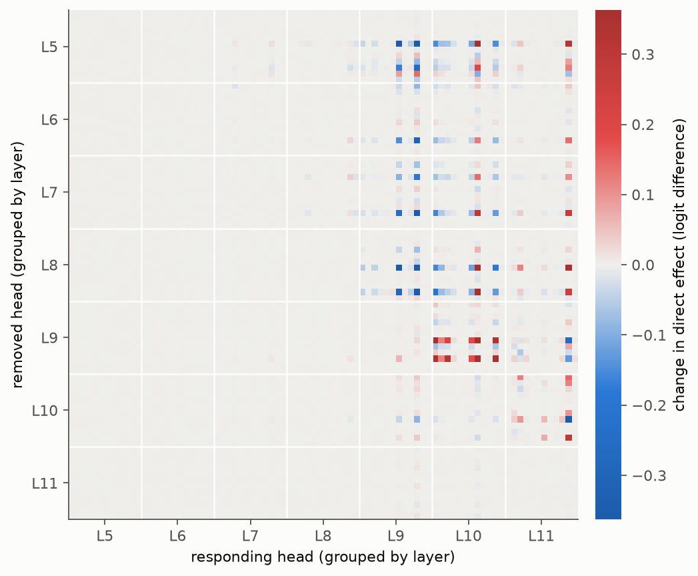
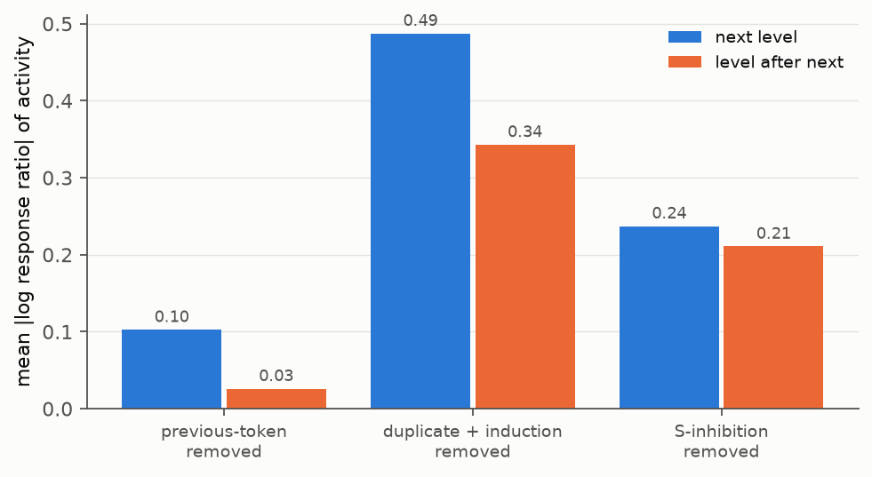
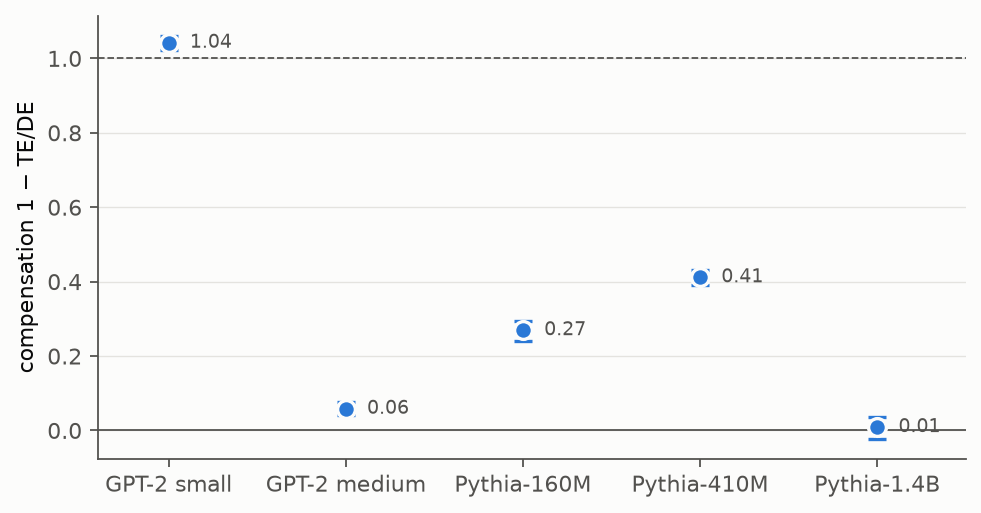
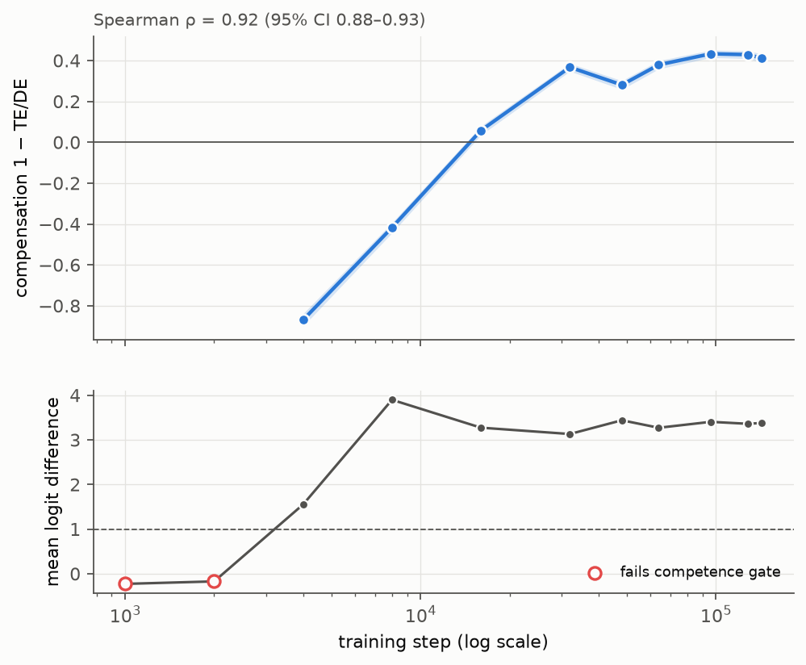
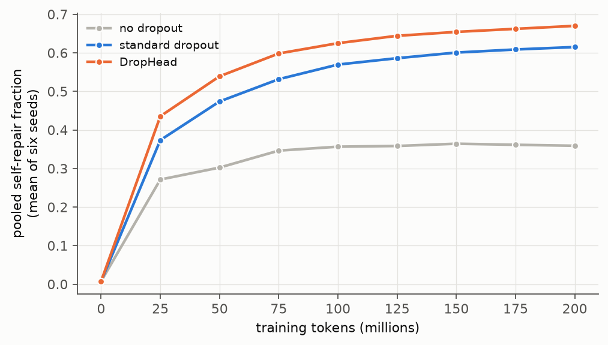
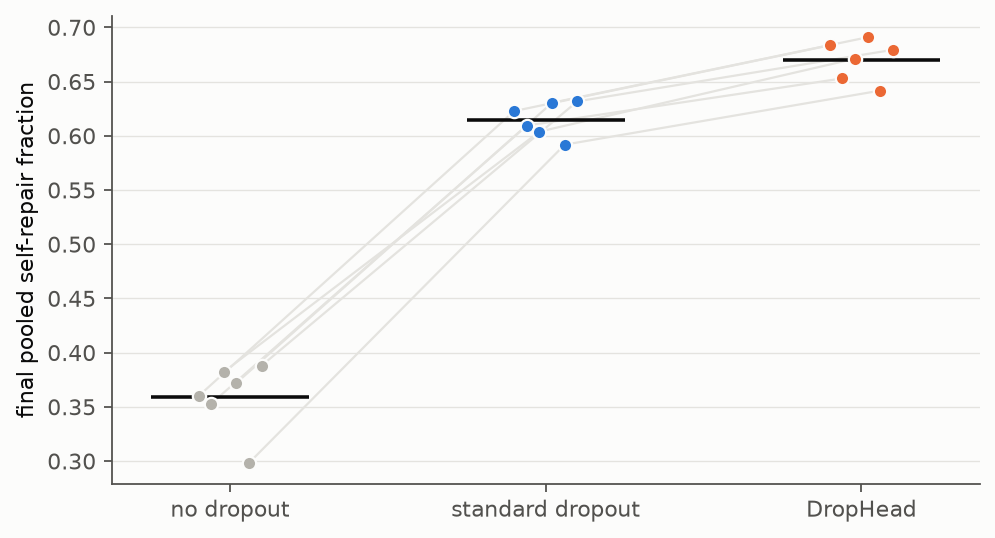

# What Happens When Parts of a Transformer Are Removed?

*Measures that ecologists use for species-removal experiments, applied to the attention heads of GPT-2 and four other language models, and eighteen small models trained from scratch to test whether dropout is what makes a transformer repair itself.*


Ecologists learn how a community of plants and animals fits together by removing one species and recording what happens to the others. Removing a predator changes the animals it eats, and through them the plants those animals eat; ecologists call this chain of effects a *trophic cascade* ("trophic" means to do with feeding). People who study how language models work run the same kind of experiment. The models here are *transformers*, built in layers, and each layer contains several *attention heads*: small units that each choose which earlier words in the text to draw information from and pass what they find on to later layers. Switching one head off and measuring how the model's output changes is called *ablation*. When a head is ablated, other heads often make up for part of what it did.

The researchers who first described this in GPT-2 suggested that it comes from *dropout*, a training method that switches off random parts of the model at each training step so that the model cannot rely on any one of them ([Wang et al 2022](#references)). [McGrath et al 2023](#references) later found repair in a model trained without dropout, which shows that dropout is not needed for it, but I could not find a test of whether dropout makes the repair larger. So I wanted to know two things: whether the measures ecologists built for removal experiments say anything useful about a transformer, and whether dropout is what makes a transformer repair itself.

## What I found

1. **When GPT-2's three main heads for a simple naming task are removed, the other heads make up all of the loss and slightly more.** The model's preference for the right name rose from 3.65 to 3.85. Backup heads began to produce the answer, and heads that normally push against it stopped; together they carried 94.5% of the replacement. Ecologists call this *mesopredator release*: when a top predator is removed, smaller predators increase.
2. **The heads that matter most are not the ones that contribute most directly to the answer.** All four S-inhibition heads and three of the four induction heads have almost no direct effect, yet removing any one of them costs 10% to 37% of the preference for the right name. Ecologists call a species like this a *keystone*: its effect on its community is large compared with how common it is.
3. **The effect of a removal shrinks with distance.** Removing one group of heads changed the heads that read its output more than the heads one step further on, in all three steps tested, as ecologists often find along food chains.
4. **Not every model repairs itself, and the repair develops during training.** Across five pretrained models, the share made up ranged from about 1% in Pythia-1.4B, which could not be told apart from zero, to 104% in GPT-2 small. Early in the training of Pythia-410M, removing its top heads did more damage than they contributed; by the end, the rest of the model made up 41%.
5. **Dropout makes the repair larger, but it is not needed for it.** In eighteen small models trained on the same text, the rest of the model made up 36% of a removed head's contribution without dropout, 62% with standard dropout, and 67% with dropout that switches off whole heads. The order held in all six sets of three models, and when the models were compared at the same error on held-out text.

In practice, the amount of repair varied from none to more than all of what was removed among the five models tested. Of the ecological tools, community importance picked out the heads that matter out of proportion to their direct effect, the log response ratio made the test of weakening with distance possible, and an idea drawn from the insurance hypothesis, that random loss of parts during training would produce parts that can replace one another, gave the one prediction about cause, which held.

## 1. Removal experiments in ecology

In 1963 Robert Paine began removing the predatory starfish *Pisaster ochraceus* from a stretch of rocky shore at Mukkaw Bay, Washington. Barnacles and then mussels, both of which the starfish had been eating, spread over the rock, and the number of species living there fell from fifteen to eight ([Paine 1966](#references)). Several of the species that disappeared, such as the seaweeds, the sponge and the sea slug that fed on it, are not eaten by the starfish; its effect on them was indirect, through the barnacles and mussels that took their space. Ecologists call a species whose effect on its community is this large relative to its numbers a keystone ([Power et al 1996](#references)). Sea otters, the plant-eating invertebrates they eat, and the kelp and other large seaweeds those invertebrates eat form the same kind of chain ([Estes & Palmisano 1974](#references)). An example of mesopredator release comes from fragmented scrub near San Diego, where canyons with few or no coyotes held more domestic cats, raccoons and foxes, and fewer species of scrub-breeding birds ([Crooks & Soulé 1999](#references)).

Ecologists turned such observations into measures and general findings. The ones used here are:

- **Interaction strength.** The effect of species A on species B, measured by comparing B with and without A; [Paine 1992](#references) divided the change by the number of A present, giving an effect per individual.
- **The log response ratio.** The logarithm of a quantity, such as a population's density, under a treatment divided by the same quantity in an untreated control. It treats an increase and a decrease of the same proportion equally ([Hedges et al 1999](#references)).
- **Attenuation.** Across 102 field experiments that compared communities with and without predators, a predator's effect on the animals it eats was usually larger than its effect on the plants those animals eat (in every type of ecosystem except streams): the effect of a predator often weakens as it passes down the food chain ([Shurin et al 2002](#references)).
- **Community importance.** [Power et al 1996](#references) define a keystone as a species "whose impact on its community or ecosystem is large, and disproportionately large relative to its abundance". Their measure is the proportional change in a property of the community when the species is removed, divided by the species' share of the community. A species whose effect matches its share scores 1, or −1 if the property rises when it is removed; a keystone scores well above 1 in absolute value.
- **The insurance hypothesis.** A community whose species respond differently to changing conditions keeps up its overall function better than one of identical species, because the loss of one is made up by the others ([Yachi & Loreau 1999](#references)). It describes the benefit of such a community when conditions vary; it does not say what produces the redundancy. My prediction for transformers extends the idea: if parts are randomly lost during training, as they are under dropout, the model should develop parts that can replace one another.

## 2. Removal experiments in transformers

[Wang et al 2022](#references) worked out how GPT-2 small ([Radford et al 2019](#references)) completes sentences such as "When Mary and John went to the store, John gave a drink to". The right answer is the name that is not repeated, Mary. The three heads that contribute most directly, the *name movers*, look back from the last word to the right name and copy it to the output. When all three were switched off, the preference for the right name fell by only 5%, because other heads changed their contribution: eight *backup name movers* increased theirs, and the heads that normally push against the right name pushed less. They wrote: "We hypothesize that this compensation phenomenon is caused by the use of dropout during training."

[McGrath et al 2023](#references) found the same repair between whole layers of a 7-billion-parameter model "trained entirely without dropout, stochastic depth, or layer dropout", and called it the *Hydra effect*. So dropout is not necessary for repair; whether it increases repair is a separate question. [Rushing & Nanda 2024](#references) measured *self-repair*, the part of a removed head's contribution that the rest of the model restores, across several model families, and found it widespread but imperfect and noisy. They estimate that "possibly 30%" of it comes from the final normalisation step, which rescales the sum of all the parts' outputs before the model answers. [McDougall et al 2024](#references) showed that GPT-2's head 10.7, one of Wang et al's two *negative name movers*, lowers the score of words that appear earlier in the text and that earlier layers already predict; with the name movers removed it has less to lower. [Tigges et al 2024](#references) followed this circuit through the training of the Pythia models and found that individual heads gain and lose their roles while the circuit's method stays the same; they suggest that self-repair may contribute to this stability and leave its mechanism to future work.

To use the ecological measures, I treated each head as a species. Its "abundance" is how much it contributes directly to the answer; removing it means replacing its output with its average; backup heads that increase when the name movers are removed are a mesopredator release; and the levels of the circuit, from the earliest heads to the name movers, are the levels of a food chain. This is a correspondence of measures, not of systems: a transformer computes its answer in one pass with no feedback and no time, while an ecological cascade runs over many generations.

## 3. Measuring a removal

The test uses 600 sentences of the kind above, built from Wang et al's 15 templates. Every name, place and object is a single *token*, the unit of text a model reads, in both GPT-2 and Pythia, so every model sees the same sentences. Each sentence has a twin with three different names and no repetition, which keeps the structure and removes what the circuit depends on.

- **Logit difference.** The model scores every possible next word; the difference between its scores for the right name and the repeated name measures its preference. GPT-2 small prefers the right name on 99.0% of the sentences, with a mean logit difference of 3.65; Wang et al report 99.3% and 3.56 on theirs.
- **Removal.** A head's output is replaced by its average over the twin sentences. This keeps the head's average contribution and removes what depends on the particular sentence, which is closer to holding a population at a fixed size than to wiping it out.
- **Direct effect.** Apart from one rescaling at the end, the model's answer is a sum of the outputs of all its parts, so each head's own contribution to the logit difference can be computed ([Elhage et al 2021](#references)). This is the head's abundance.
- **Compensation.** The share of the removed heads' direct effect that the rest of the model makes up: 0 is none, 1 is all, above 1 means the preference ends up higher than before, and below 0 means the rest of the model adds to the damage.

## 4. What I decided in advance

A test written after seeing the result can be made to fit it, so the hypotheses, their criteria and the methods were written down first and committed to the project's repository at 17:17 US Central on 24 September 2026, before any registered experiment was run ([commit `cca53fc`](https://github.com/kvenanzi/trophic-cascade/blob/cca53fc/docs/post/README.md)).

One result was known before that. While the measurement code was being checked against Wang et al's numbers, a run that removed the three name movers found that the preference for the right name *rose*, from 3.65 to 3.85, where Wang et al report a 5% fall. So question 1 repeats a known result; it was written so that it could still fail on its range and on which heads carry the repair. Every other question concerns a number that had not been computed when it was written.

| Question | What would count as yes | Result |
|---|---|---|
| 1. Does the rest of GPT-2 small make up for the name movers, mostly through the backup and negative name movers? | Compensation range above 0; those heads carry at least half of the replacement | **Yes.** Compensation 1.042 (95% range 1.023 to 1.061); those heads carried 94.5%. |
| 2. Are the S-inhibition heads and some earlier heads keystones, and the name movers not? | At least three of four S-inhibition heads and one previous-token, duplicate-token or induction head have a removal effect of at least 5% and community importance of at least 2 in size; the name movers score below 1 | **Yes, except one clause.** Four S-inhibition, three induction and one duplicate-token head are keystones, and no name mover is; but name mover 10.0 scores 1.51. |
| 3. Does the effect of removing a circuit level shrink with distance? | Response one level down larger than two levels down for three removals, with the range above 0 in at least two | **Yes.** In all three, all three ranges above 0. |
| 4. Does every model that can do the task make up part of a removal? | Compensation range above 0 in every model that passes a competence test | **No.** Four of five; Pythia-1.4B 0.009 (−0.023 to 0.037). |
| 5. Does the repair grow during training in Pythia-410M? | Rank correlation of training step and compensation with its range above 0 | **Yes.** 0.92 (0.88 to 0.93). |
| 6. Does self-repair rise from no dropout to standard dropout to head dropout? | Each paired difference with its range above 0 and positive for at least five of six seeds | **Yes.** 0.359, 0.615, 0.670; six of six seeds for both. |
| 7. Does that order hold at the same validation loss? | The same test against the no-dropout model at its closest validation loss | **Yes.** +0.251 and +0.309, six of six seeds. |

Three phrases in the registered text were reworded later to remove figures of speech, without changing any prediction or criterion. The training length for the dropout experiment was fixed in advance by a rule applied to a timing run (Details B).

## 5. Mesopredator release in GPT-2

Removing the three name movers takes away 4.76 units of direct effect, yet the mean logit difference rises from 3.65 to 3.85. Compensation is 1.042 (95% range 1.023 to 1.061): the rest of the model makes up 104% of what was removed. A second removal method, which uses the twin sentence's output in place of the average, gives 0.997 (0.978 to 1.016). The two methods disagree about whether the model makes up a little more than everything or exactly everything; both put it close to all.



*Figure 1. GPT-2 small: direct effect on the logit difference of the ten heads whose direct effect changed most when the name movers 9.9, 9.6, and 10.0 were mean-ablated together, intact (grey) and after the removal (blue). n = 600 prompts. Data: `figures/data.json`.*

The eight backup name movers carry 56.9% of the replacement and the two negative name movers 37.5%, together 94.5%. The largest single response is head 10.7, whose direct effect goes from −2.06 to +0.07: with the name movers gone, the head that lowers what they predict has nothing to lower, as [McDougall et al 2024](#references) describe. The replacement comes almost entirely from what the heads write: the final normalisation step accounts for only 5.8% of it, below the "possibly 30%" that [Rushing & Nanda 2024](#references) give as a rough figure, measured differently, for single heads on ordinary text.

## 6. Keystone heads

Removing each of GPT-2 small's 144 heads alone gives each head's total effect on the logit difference, and with its direct effect, its community importance.



*Figure 2. Every head of GPT-2 small: abundance (share of the summed absolute direct effect, log scale) against the share of the mean logit difference lost when the head alone is mean-ablated. The dashed curves are CI = ±1, an effect in proportion to abundance. Keystones and the heads with abundance above 0.05 are labelled. n = 600 prompts. Data: `figures/data.json`.*

Fourteen heads meet the registered definition of a keystone, among them all four S-inhibition heads, three of the four induction heads and one of the three duplicate-token heads. These write almost nothing to the output themselves, but they direct the heads that do; removing S-inhibition head 8.6 alone costs 37% of the logit difference. Ranked by the share lost on removal, the top four heads are 8.6, 8.10, 5.5 and 7.9; ranked by direct effect, they are 9.9, 10.7, 9.6 and 11.10. Community importance names the relation between the two lists, which neither ranking shows on its own.

No name mover is a keystone, but the prediction that all three would score below 1 failed for 10.0, which costs 9.5% of the logit difference against a share of 6.3%. The measure has the same defect here as in ecology: for a head with almost no direct effect it becomes extremely large (145,070 for head 3.0), which is why the registered definition also required a removal effect of at least 5%.

Two results were not predicted. First, four heads have *negative* community importance: removing them raises the logit difference, by 46% for 10.7, 29% for 11.10, 9% for 11.2 and 6% for 5.10. [Power et al 1996](#references) expected this sign for a species that consumes the measured property ("negative values occur when a community characteristic increases after removal of a species, as would be the case if … the first species were a consumer"). These heads are the closest thing in the model to a predator in the literal sense. Second, heads 6.0 and 5.10 are keystones but belong to none of Wang et al's groups; both sit before the S-inhibition heads, and I did not examine them further.

The 144 removals also give every head's interaction strength on every other: how much each head's direct effect changes when another is removed.



*Figure 3. GPT-2 small: the change in the direct effect of each head in layers 9–11 (columns) when each of the 144 heads is removed alone (rows). Red is an increase, blue a decrease. Heads in layers 0–8 are omitted as columns because none of them responds by more than 0.05. n = 600 prompts. Data: `figures/data.json` (the fifteen largest entries).*

Of the 20,736 pairs, 115 have an interaction strength above 0.05 in size, and every responding head is in the last three layers. The largest entries follow the circuit: removing name mover 9.9 raises 10.7 by 1.23, and removing S-inhibition head 8.6 lowers 9.9 by 1.21 and raises 10.7 by 0.70. Removing any S-inhibition or induction head gives the same pattern, lower name movers and higher negative name movers, which is what a two-step cascade looks like: the effect on the negative name movers passes through the name movers.

## 7. Effects shrink with distance

To test attenuation, each level of the circuit was removed as a group, and the change in activity of the heads one and two levels further on was measured with the log response ratio. A head's *activity* is the size of its output.



*Figure 4. GPT-2 small: mean absolute log response ratio of head activity at the next circuit level (blue) and the level after it (orange) when each level is removed as a set. n = 600 prompts. Data: `figures/data.json`.*

The response was larger one level down than two levels down in all three cases, and the range of the difference was above zero in all three. The size of the weakening differs between the steps. Removing the earliest heads changes the induction heads and leaves the S-inhibition heads within 5%, while the step from the S-inhibition heads to the name movers and then to the negative name movers is small (0.237 against 0.211). Nearly every response is a decrease. No level showed a release like the one in section 5: in this circuit, release happens in the heads that read the name movers' output, not in the heads that feed them. Because this is one circuit, it shows that the measure applies, not that transformers in general behave this way.

## 8. Other models, and repair during training

The same removal was repeated in four other pretrained models, in each case removing the three heads with the largest direct effect. All five models can do the task.



*Figure 5. Compensation (1 − TE/DE) when the three heads with the largest positive direct effect are mean-ablated together, with 95% bootstrap intervals. 0 is no compensation; 1 is full compensation. n = 600 prompts per model. Data: `figures/data.json`.*

Four of the five make up part of the removal; Pythia-1.4B does not. Removing its three largest heads costs 1.80 of their 1.81 units of direct effect, so the rest of the model restores about 1%, and the range includes zero. Question 4 therefore failed. The share made up varies by a factor of more than a hundred: about 1% in Pythia-1.4B, 6% in GPT-2 medium, 27% and 41% in the two smaller Pythia models, and 104% in GPT-2 small. It does not follow model size within either family.

The Pythia models come with saved snapshots from their training, so Pythia-410M was measured at eleven points, with the top three heads chosen again at each.



*Figure 6. Pythia-410M at eleven training checkpoints. Top: compensation of the top three heads, re-selected at each checkpoint, with 95% intervals (shaded, narrower than the line at most points), for the nine checkpoints that pass the competence gate. Bottom: mean logit difference; hollow red points fail the gate. n = 600 prompts per checkpoint. Data: `figures/data.json`.*

The repair grows with training: the rank correlation between training step and compensation is 0.92 (0.88 to 0.93). How it grows was not predicted. At the first two points where the model can do the task, compensation is strongly *negative*: at step 4,000, removing the top three heads costs 1.87 times what they contributed directly, and at step 8,000, 1.42 times. The rest of the model adds to the loss, which [Rushing & Nanda 2024](#references) call downstream breakage. Compensation crosses zero between steps 8,000 and 16,000 and reaches about 0.4 by step 32,000, after which it changes little. Since the model already solves the task on 99% of sentences at step 8,000, it first solves it with a circuit that breaks more than proportionally when its top heads are removed. Ecologists have predicted that communities become more self-regulating and more resistant to disturbance as they mature ([Odum 1969](#references)), and that is the direction seen here.

## 9. Does dropout produce the repair?

The models above differ in many ways besides dropout, so they cannot test Wang et al's suggestion. Even GPT-2's use of dropout is uncertain: its [Hugging Face configuration](https://huggingface.co/openai-community/gpt2/blob/main/config.json) sets dropout to 0.1, but [the code OpenAI released](https://github.com/openai/gpt-2/blob/master/src/model.py), which only runs the trained model, contains none, and the paper ([Radford et al 2019](#references)) does not mention dropout, saying only that the model largely follows the earlier GPT model, which used it.

So eighteen small models were trained from scratch, identical except for dropout: 30-million-parameter GPT-2-style models, each trained on 200 million tokens of TinyStories, a collection of short, simple stories ([Eldan & Li 2023](#references)). Six had no dropout, six standard dropout, and six *head dropout*, which switches off whole attention heads at random during training ([Zhou et al 2020](#references)) and so removes the same unit the experiment removes. Each of six *seeds*, the numbers that set the random choices, fixed the starting weights and the order of the text, so the three models of a seed differ only in dropout.

Each model was measured with dropout off. One head at a time was removed by giving it the output it produced on a different text. The *pooled self-repair fraction* is the share of the removed heads' direct effect on the next word that the rest of the model restores.



*Figure 7. Pooled self-repair fraction (the share of a resample-ablated head's direct effect that the rest of the model restores) at initialisation and after each eighth of training, mean of six seeds per regime. n = 65,536 held-out token positions per measurement. Data: `figures/data.json`; runs in sweep `fhuassaa`.*



*Figure 8. Final pooled self-repair fraction of each of the eighteen models. Grey lines join the three models of one seed, which share initialisation and data order; black bars are the means. Data: `figures/data.json`.*

<!-- qmd
::: {.column-page-right}
```{=html}
<iframe src="figures/partb_runs.html" title="Part B runs, one line per run"
        loading="lazy" style="border:none;width:100%;height:520px"></iframe>
```
:::
-->

The interactive chart [`figures/partb_runs.html`](figures/partb_runs.html) draws each of the eighteen runs of Figures 7 and 8 as its own line. Its menu switches between pooled and mean self-repair, self-repair in each of the six layers, validation loss, and training loss. The training loss is the loss of one batch, logged every 50 steps with the run's dropout active, so unlike the validation loss, which is measured with dropout off, it does not compare the regimes on equal terms. Hovering over a point gives the run's seed and training step, and clicking a regime in the legend hides or shows it.

Without dropout the rest of the model restored 36% of a removed head's contribution, with standard dropout 62%, and with head dropout 67%. Standard dropout raised the fraction by 0.256 (95% range 0.231 to 0.281) and head dropout by another 0.055 (0.045 to 0.065), both for all six seeds.

Dropout also slows training, so a dropout model might differ only because it is less trained. Each dropout model was therefore also compared with its no-dropout partner at the point where that partner's *validation loss*, its error on held-out text, was closest. The differences were almost unchanged (+0.251 and +0.309, against +0.256 and +0.311), because the no-dropout models had stopped gaining self-repair long before. Head dropout also had *lower* validation loss than standard dropout for every seed, and *higher* self-repair.

Figure 7 shows where the difference arises. All three groups start at 0.008 and have separated after 25 million tokens (0.27, 0.37 and 0.44). The no-dropout models level off near 0.36 by 100 million tokens, while both dropout groups keep rising to the end. Dropout does not create the repair, which reaches 0.27 without it; it keeps building it after the models without dropout have stopped.

## 10. What could be wrong

- **One task.** The keystone and attenuation results rest on one circuit in one model. Whether they hold for other tasks was not measured.
- **Three heads per model.** Questions 4 and 5 measured the repair for the top three heads by direct effect. Pythia-1.4B might make up for a different set of heads.
- **One removal method for most results.** The second removal method was run only for question 1, where it gave nearly the same answer (0.997 against 1.042).
- **One size, one dataset, one dropout rate.** The dropout experiment used 30-million-parameter models, simple stories, and a dropout rate of 0.1. The effect is large compared with its range, but its size at other scales, rates and data is unknown.
- **Normalisation counts as repair.** In the dropout experiment, repair through the final normalisation step counts as self-repair, as registered. How much of the dropout difference comes from normalisation rather than from other heads was not separated.
- **The matched comparison is coarse.** Models were compared at the nearest of nine measurement points, whose validation loss was within 0.006 of the dropout model's. The no-dropout self-repair changed by less than 0.01 over the second half of training, so a finer match would not change the result, but it was not run.
- **The ecological correspondence is a correspondence of measures.** A transformer's single pass has no feedback, no time and no equilibrium. Nothing here shows that transformers are ecosystems, only that measures designed for ecosystems give interpretable answers when applied to heads.

## 11. What I take from this

Wang et al's suggestion is partly right. Dropout is not necessary for repair: the small models trained without it restore 36%, the Pythia models, trained without dropout, restore 27%, 41% and 1%, and McGrath et al found repair in a model trained without it. But dropout makes the repair much larger, by 26 percentage points under identical data, starting weights and training length, in every seed, and head dropout, which removes the same unit the experiment removes, had the largest effect. That fits the prediction I drew from the insurance hypothesis, that random loss of parts during training produces parts that can replace one another. [Rohweder et al 2026](#references) explain the Hydra effect from the structure of the training data, together with properties of gradient descent and of the model's internal representations; their account does not mention dropout. That account can explain the repair present without dropout, but it does not predict the differences found here between models that share data and training method.

Of the ecological measures, community importance picked out the keystones, a group that a ranking by direct effect or by removal effect alone does not identify, and its sign marked the heads that work against the answer. The log response ratio put heads with very different output sizes on one scale, which made the attenuation test possible. Mesopredator release and interaction strength are quantities interpretability already uses; [Wang et al 2022](#references) found the backup heads by the same measurement. What the ecological framing added there was a prediction about direction: the heads that increased were the ones the name movers had kept low, and the heads that feed the name movers showed no release.

Next steps would be to separate the part of the dropout effect that goes through normalisation, repeat the dropout experiment at a second model size and dropout rate, remove heads during training in a fixed rather than random pattern, look for where Pythia-1.4B's repair is, if anywhere, and measure keystones and attenuation in a second circuit.

## Details for anyone who wants to check the work

### A. Data

- **Sentences for the naming task:** fifteen templates, those of Wang et al's BABA set, each filled 40 times with a random right name, repeated name, place and object, half with the right name first in the opening clause (ABBA) and half with the repeated name first (BABA): 600 prompts, seed 0 (`trophic/ioi.py`). Names, places and objects are restricted to words that are single tokens, with a leading space, under both the GPT-2 and the Pythia tokenizer, and every prompt of a template has the same length in tokens; 72 names, 17 places and 18 objects qualify. Each prompt has an *ABC* twin with the same template, name order, place and object and three other distinct names. The ABC prompts' activations are the reference for mean ablation.
- **TinyStories:** about 2.1 million short stories ([Hugging Face release](https://huggingface.co/datasets/roneneldan/TinyStories)) written by GPT-3.5 and GPT-4 in the vocabulary of a young child ([Eldan & Li 2023](#references)), tokenized with the GPT-2 tokenizer, joined with an end-of-text token between stories, and cut into sequences of 256 tokens. The published validation split is held out for validation loss and the self-repair measurement.

### B. Models and measurement

**Measurement in the pretrained models.** TransformerLens 3.9 ([Nanda & Bloom 2022](#references)) with its default weight processing, under which the final LayerNorm only rescales the residual stream, so that the per-component outputs, divided by that scale, sum exactly to the logits; a unit test checks that direct effects add up to the logit difference to 0.01. For right name IO and repeated name S:

- **logit difference:** logit(IO) − logit(S) at the last position;
- **direct effect:** the head's output at the last position minus its ABC mean, divided by the final LayerNorm scale and projected on W_U[IO] − W_U[S] ([Elhage et al 2021](#references)); zero for a mean-ablated head. It is computed with both the run's own scale and the intact run's, and the difference is the share of a change that runs through normalisation ([Rushing & Nanda 2024](#references));
- **activity:** the norm of (z − z̄)W_O at the position where the head's group acts (S1+1 for previous-token heads, S2 for duplicate-token and induction heads, the last position otherwise);
- **compensation:** c = 1 − TE/DE, with TE the fall in mean logit difference and DE the removed heads' summed mean direct effect; above 1 corresponds to the ecological hydra effect;
- **community importance:** CI_i = [(t_N − t_D) / t_N] · (1 / p_i), with t the mean logit difference intact (N) and with head *i* removed (D), and p_i the head's share of the summed absolute direct effect ([Power et al 1996](#references)). A keystone has a removal effect of at least 5% and |CI| ≥ 2.

Mean ablation replaces the head's output z before the output projection, at every position, by its mean over the 40 ABC prompts of the same template; in ecological terms it is a sustained ("press") removal. Resample ablation substitutes the paired ABC prompt's z and was run once on GPT-2 small as a check ([Heimersheim & Nanda 2024](#references) describe both). Intervals are percentile bootstraps over the 600 prompts, 2,000 resamples.

**The GPT-2 small circuit**, from Wang et al's Figure 2, used as the levels for question 3 and the named sets for questions 1 and 2:

| Level | Group | Heads (layer.head) |
|---|---|---|
| L1 | previous-token | 2.2, 4.11 |
| L2 | duplicate-token | 0.1, 3.0, 0.10 |
| L2 | induction | 5.5, 6.9, 5.8, 5.9 |
| L3 | S-inhibition | 7.3, 7.9, 8.6, 8.10 |
| L4 | name mover | 9.9, 9.6, 10.0 |
| – | backup name mover | 9.0, 9.7, 10.1, 10.2, 10.6, 10.10, 11.2, 11.9 |
| L5 | negative name mover | 10.7, 11.10 |

Backup name movers have no level: they work beside the name movers rather than after them.

**Experiments.** All 144 single-head removals in GPT-2 small (the interaction matrix, and every head's community importance and compensation); set removals of the name movers, each circuit level and every group; the top three heads by positive direct effect in GPT-2 medium and Pythia-160M, -410M and -1.4B; and Pythia-410M at steps 1,000, 2,000, 4,000, 8,000, 16,000, 32,000, 48,000, 64,000, 96,000, 128,000 and 143,000 (the final model), with the top three chosen again at each, since [Tigges et al 2024](#references) show they change. The competence gate requires the right name on at least 80% of prompts and a mean logit difference of at least 1.0.

**The dropout experiment.** Hugging Face `GPT2LMHeadModel`, 6 layers, 8 heads of dimension 48 (d_model 384), MLP width 1,536, context 256, tied embeddings, GPT-2 tokenizer. AdamW, peak learning rate 1e-3 with 2% linear warm-up and cosine decay to 10%, weight decay 0.1, batch 128 sequences (32,768 tokens). The token budget was fixed before the sweep, from one timing run, at the largest multiple of ten million tokens that trains in 20 minutes or less on a Colab A100, and was not revised after any result. The arms: *none*; *standard*, dropout 0.1 on embeddings, attention weights and residual branches; *drophead*, no other dropout, and each head's output zeroed independently per sequence with probability 0.1 and the surviving heads scaled by 1/0.9. Six seeds (0–5) per arm, 18 runs, one W&B sweep.

Every model is measured in evaluation mode, with all dropout off, inside the training job after each eighth of the token budget and also at step 0, which gives nine points per run; the step-0 value appears in Figure 7 and is used by no test. At each point, 256 held-out sequences (65,536 token positions) are run intact and then once with each of the 48 heads resample-ablated, taking the head's output from the next sequence in the batch at the same position. Following [Rushing & Nanda 2024](#references), Δlogit is the change in the logit of the correct next token and ΔDE the change in the head's own direct effect on it, computed with the intact run's final-LayerNorm scale, so compensation through normalisation counts as self-repair. Self-repair is Δlogit − ΔDE, over the 2% of positions where the head's intact direct effect is largest. The pooled fraction is total self-repair over all heads and positions divided by the total of −ΔDE; the unweighted mean of each head's fraction is secondary.

**Statistics for the dropout experiment.** The unit is the seed. For each contrast the six within-seed differences give a mean, a 95% t interval and a sign count. With six units, six of six positive is the only sign count with two-sided p < 0.05 under a sign test; five of six was registered as consistent but not significant on its own.

### C. Full results

The experiments on pretrained models, called Part A in the code and run names (the dropout experiment is Part B), were run twice: on a local GTX 1070 and on a Colab A100 (the reference set, `notebooks/01_part_a.ipynb`). The two agree to the fifth decimal place on every quantity below (baseline logit difference 3.645846 against 3.645847; name-mover compensation 1.041904 against 1.041904; identical keystone lists), and the prompt file was byte-identical. Pythia-1.4B and the checkpoints were run on the A100 only, because Pythia-1.4B could not be loaded on the local machine: TransformerLens's weight processing holds two copies of the weights in host memory, which exceeded the 15 GB available.

**Baseline.** The twelve GPT-2 small heads with the largest absolute direct effect are 9.9 (+2.86), 10.7 (−2.06), 9.6 (+1.22), 11.10 (−1.02), 10.0 (+0.68), 10.10 (+0.54), 10.6 (+0.36), 11.2 (−0.31), 8.10 (+0.28), 10.1 (+0.23), 7.9 (+0.20) and 7.3 (+0.10): the three name movers, both negative name movers, four backup name movers and three S-inhibition heads. The three heads of largest positive direct effect, which question 4 selects automatically in every other model, are exactly Wang et al's name movers.

**Question 1.** Mean ablation: compensation 1.042 (95% CI 1.023–1.061). Resample ablation: 0.997 (0.978–1.016). The offset, the 4.96 units by which the logit difference exceeds what the removal alone would leave, is carried as follows:

| Component | Change in direct effect | Share of offset (95% CI) |
|---|---|---|
| eight backup name movers | +2.82 | 0.569 (0.558–0.580) |
| two negative name movers | +1.86 | 0.375 (0.366–0.384) |
| all other heads | +0.31 | 0.063 (0.057–0.070) |
| MLP layers | −0.04 | −0.008 (−0.013 to −0.003) |
| backup and negative together | +4.69 | **0.945 (0.937–0.952)** |

The backup name movers 10.10, 10.2, 10.6, 11.2 and 10.1 each increase by 0.26 to 0.81. The final LayerNorm scale falls by 7.4%, and that change accounts for 5.8% of the offset (5.6–6.1%). The MLP layers act slightly against the compensation, the opposite direction to the "erasure" layers of [McGrath et al 2023](#references), late MLP layers that normally reduce the logit of the most likely token and reduced it less after a removal, which added to their compensation.

**Question 2.** Fourteen keystones:

| Head | Group | Abundance | Share of trait lost | CI |
|---|---|---|---|---|
| 8.6 | S-inhibition | 0.0049 | 0.366 | 74.9 |
| 8.10 | S-inhibition | 0.0256 | 0.291 | 11.4 |
| 5.5 | induction | 0.0001 | 0.279 | 2,973 |
| 7.9 | S-inhibition | 0.0189 | 0.275 | 14.6 |
| 6.9 | induction | 0.0001 | 0.152 | 1,160 |
| 3.0 | duplicate-token | < 0.0001 | 0.144 | 145,070 |
| 7.3 | S-inhibition | 0.0092 | 0.128 | 13.9 |
| 5.9 | induction | 0.0001 | 0.102 | 1,380 |
| 9.7 | backup name mover | 0.0070 | 0.094 | 13.5 |
| 6.0 | – | 0.0017 | 0.052 | 29.7 |
| 5.10 | – | 0.0004 | −0.061 | −149 |
| 11.2 | backup name mover | 0.0291 | −0.091 | −3.1 |
| 11.10 | negative name mover | 0.0947 | −0.287 | −3.0 |
| 10.7 | negative name mover | 0.1913 | −0.461 | −2.4 |

The name movers' CI values are 0.34 (9.9), −1.33 (9.6) and 1.51 (10.0). The CI values of heads with near-zero direct effect, such as 145,070 for 3.0, carry no information beyond "large"; for those heads the share of the trait lost is the informative quantity.

**Interaction matrix.** Of the 20,736 ordered pairs, 115 have an interaction strength above 0.05 in absolute value. The responding heads are in layers 9 (36), 10 (53) and 11 (26); the removed heads that produce them are in every layer from 0 to 10 except 1 and 2. Only two of the 115 have the responding head at or before the removed head's layer, which can happen only through the final LayerNorm scale. Other large entries: removing induction head 5.5 lowers 9.9 by 0.63, and removing 10.7 lowers 11.10 by 0.59. With the final LayerNorm scale held at its intact value, 98.8% of the summed absolute interaction strength remains.

**Question 3.**

| Level removed | Next level | \|LRR\| | Level after next | \|LRR\| | Difference (95% CI) | Logit difference after removal |
|---|---|---|---|---|---|---|
| L1 previous-token | L2 duplicate + induction | 0.103 | L3 S-inhibition | 0.026 | +0.077 (0.073–0.081) | 3.39 |
| L2 duplicate + induction | L3 S-inhibition | 0.487 | L4 name mover | 0.343 | +0.144 (0.127–0.161) | 0.31 |
| L3 S-inhibition | L4 name mover | 0.237 | L5 negative name mover | 0.211 | +0.026 (0.016–0.040) | 0.40 |

Removing the previous-token heads changes induction heads 5.8 (LRR −0.31) and 6.9 (−0.17), leaves the S-inhibition heads within 5%, and costs 7% of the logit difference. Removing the S-inhibition heads lowers the activity of 9.9 and 9.6 by 30% (LRR −0.36 and −0.35), leaves 10.0 unchanged, and lowers 10.7 and 11.10 by 21% and 17%. The only increases are small and follow the removal of the previous-token heads: induction head 5.9 +8%, S-inhibition heads 7.9 and 8.10 +2% and +1%.

**Question 4.**

| Model | IO preferred | Mean logit difference | Top three heads | DE removed | TE | Compensation (95% CI) | Share through LayerNorm |
|---|---|---|---|---|---|---|---|
| GPT-2 small | 0.990 | 3.65 | 9.9, 9.6, 10.0 | 4.76 | −0.20 | 1.042 (1.023–1.061) | 0.058 |
| GPT-2 medium | 1.000 | 3.87 | 19.1, 15.14, 20.6 | 1.68 | 1.58 | 0.058 (0.041–0.076) | 0.23 |
| Pythia-160M | 0.978 | 3.99 | 8.9, 8.10, 8.2 | 3.11 | 2.27 | 0.269 (0.241–0.295) | 0.15 |
| Pythia-410M | 1.000 | 3.38 | 11.4, 18.8, 17.10 | 2.09 | 1.23 | 0.411 (0.391–0.432) | 0.03 |
| Pythia-1.4B | 0.998 | 3.89 | 10.7, 15.15, 13.1 | 1.81 | 1.80 | **0.009 (−0.023 to 0.037)** | – |

The share through the final LayerNorm ranges from 3% to 23% where it is defined; it is not defined for Pythia-1.4B, whose offset is about zero. Question 4 was a universal claim over the models that pass the gate, so one competent model without compensation refutes it. Compensation in Pythia-1.4B could be carried by heads outside the top three; the registered test was the top three by direct effect, and the result is for that test. GPT-2 small's overcompensation (1.04) beside GPT-2 medium's 0.06, from the same published training setup, shows how much varies between models trained the same way.

**Question 5.**

| Step | IO preferred | Mean logit difference | Top three heads | Compensation (95% CI) |
|---|---|---|---|---|
| 1,000 | 0.407 | −0.23 | – | fails gate |
| 2,000 | 0.473 | −0.17 | – | fails gate |
| 4,000 | 0.828 | 1.55 | 11.4, 13.5, 12.0 | −0.870 (−0.900 to −0.839) |
| 8,000 | 0.988 | 3.90 | 11.4, 13.5, 17.6 | −0.417 (−0.444 to −0.394) |
| 16,000 | 0.982 | 3.27 | 11.4, 13.5, 17.6 | 0.057 (0.035–0.079) |
| 32,000 | 0.993 | 3.13 | 11.4, 13.5, 17.6 | 0.367 (0.347–0.386) |
| 48,000 | 0.998 | 3.44 | 11.4, 17.6, 13.5 | 0.281 (0.258–0.301) |
| 64,000 | 0.998 | 3.27 | 11.4, 18.8, 17.10 | 0.379 (0.359–0.399) |
| 96,000 | 1.000 | 3.40 | 11.4, 18.8, 17.10 | 0.433 (0.414–0.451) |
| 128,000 | 1.000 | 3.36 | 11.4, 18.8, 17.10 | 0.429 (0.409–0.448) |
| 143,000 | 1.000 | 3.38 | 11.4, 18.8, 17.10 | 0.411 (0.391–0.432) |

Spearman ρ over the nine checkpoints that pass the gate is 0.92 (95% CI 0.88–0.93). The interval resamples prompts, holding the checkpoints fixed, so it describes the uncertainty in each checkpoint's compensation, not the uncertainty from a different choice of checkpoints. With nine points, ρ = 0.92 has an exact permutation p-value of 0.0013 (two-sided, all 362,880 orderings). Head 11.4 is among the top three from step 2,000 on, while 18.8 and 17.10 replace 13.5 and 17.6 between steps 48,000 and 64,000, as [Tigges et al 2024](#references) observed for name-mover heads. The final checkpoint reproduces the separate Pythia-410M measurement of question 4 exactly (0.411), as it should, since it is the same model.

**Questions 6 and 7.** The timing run measured 173,971, 172,450 and 173,219 training tokens per second for the no-dropout, standard and DropHead arms on a Colab A100. The slowest arm trains 207 million tokens in 20 minutes, which fixed the budget at 200 million tokens (6,103 steps, 42% of one pass over the 474 million training tokens) before the sweep was registered. All eighteen runs of sweep `fhuassaa` finished on one A100 in 21 minutes each (1,226–1,238 s of training); none crashed and none was repeated. Each model has 30.0 million parameters, 19.3 million of them in the tied embedding.

| Regime | Pooled self-repair, mean (sd, range) | Validation loss, mean (sd) |
|---|---|---|
| no dropout | 0.359 (0.032, 0.298–0.388) | 1.6117 (0.0015) |
| standard dropout 0.1 | 0.615 (0.016, 0.592–0.632) | 1.6592 (0.0019) |
| DropHead 0.1 | 0.670 (0.019, 0.642–0.691) | 1.6256 (0.0015) |

| Contrast (paired by seed, n = 6) | Pooled self-repair, mean difference | 95% CI | Seeds positive | Validation loss, mean difference |
|---|---|---|---|---|
| standard − none | **+0.256** | +0.231 to +0.281 | 6 / 6 | +0.048 |
| DropHead − standard | **+0.055** | +0.045 to +0.065 | 6 / 6 | −0.034 |
| DropHead − none | +0.311 | +0.289 to +0.333 | 6 / 6 | +0.014 |
| standard − none, at matched validation loss | **+0.251** | +0.226 to +0.276 | 6 / 6 | – |
| DropHead − none, at matched validation loss | **+0.309** | +0.284 to +0.333 | 6 / 6 | – |

- **Size of the effect.** Standard dropout raises the pooled fraction by a factor of 1.7. The seed-to-seed standard deviation of the no-dropout arm (0.032) is an eighth of the standard-dropout effect, and six of six is the most extreme sign count possible with six units (two-sided sign-test p = 0.031).
- **Matching.** Every standard-dropout model's final validation loss (1.656–1.661) is nearest to the no-dropout run of the same seed at step 4,577, three-quarters of the way through training, where that run's loss is 1.655–1.659. Every DropHead model's (1.623–1.627) is nearest to step 5,340, where it is 1.625–1.630. The matched differences are within 0.005 of the unmatched ones; the no-dropout mean moves from 0.356 to 0.359 over the second half of training. DropHead's validation loss is lower than standard dropout's on every seed, by 0.034 on average.
- **Secondary measure.** The unweighted mean over heads gives the same order and the same six-of-six sign counts, with smaller and less stable values (0.11, 0.48 and 0.56; standard − none +0.37, 95% CI +0.26 to +0.47). It weights a head whose removal changes almost nothing the same as one that changes much, and heads of the first kind have fractions dominated by noise, often negative; the pooled measure was registered as primary for that reason.

### D. Decisions

| Decision | Reason |
|---|---|
| Hypotheses committed before the registered runs, with the one prior observation stated | A result cannot confirm a hypothesis written after it |
| One prompt set for every model, with names, places and objects that are single tokens under both tokenizers | Differences between models cannot come from differences in prompts |
| ABC twins replace all three names | Wang et al's reference distribution; keeping the first-clause names would leave part of the information the circuit uses |
| Mean ablation as the primary removal, resample ablation as a check | Mean ablation is Wang et al's; the check shows the question 1 conclusion does not depend on it |
| Direct effect relative to the mean-ablated value | A removed head's direct effect is then exactly zero, so "what was removed" is well defined |
| Direct effect reported with both the run's own and the intact LayerNorm scale | Separates changes in what heads write from changes in normalisation |
| Keystone criterion requires a 5% effect as well as \|CI\| ≥ 2 | CI grows without bound as abundance approaches zero |
| Activity, and its log response ratio, for question 3 | Direct effect is near zero for heads far from the output; activity is defined for every head |
| Top three heads chosen by direct effect for questions 4 and 5 | No hand-labelled circuit exists for the other models, and the selection must not depend on the result |
| Competence gate (80% of prompts, mean logit difference 1.0) | Compensation is undefined for a model that does not perform the task |
| The dropout experiment trains Hugging Face GPT-2 and measures in TransformerLens | TransformerLens has no dropout; its GPT-2 conversion makes the measurement identical to Part A's |
| Head dropout as a pre-hook on the output projection | The projection's input is the concatenation of the heads' outputs, so a per-head mask is exact |
| Seed fixes initialisation and data order | The three arms of a seed differ only in the regime, so the analysis can be paired |
| Measurement inside the training job, at nine points | Gives the development curves and the matched-loss checkpoints without storing 162 models |
| Token budget from a timing run under a rule fixed in advance | The budget cannot be chosen after seeing results |
| Pooled self-repair fraction as primary | The unweighted mean over heads is dominated by heads whose removal changes little |
| Every experiment on Colab, the local machine for code and small checks | Loading Pythia-1.4B exceeded the local memory and ended the session |
| Part A repeated on two machines | Agreement to the fifth decimal place shows the numbers do not depend on the hardware |

### E. Reproduction

- **Code:** [github.com/kvenanzi/trophic-cascade](https://github.com/kvenanzi/trophic-cascade). Numbered scripts take the prompts, models and TinyStories to every table and figure; `notebooks/01_part_a.ipynb` and `notebooks/02_dropout_sweep.ipynb` run them on Colab. The hypotheses are in commit `cca53fc`, which precedes every registered run.
- **Every number and figure:** `results/` holds the outputs they were computed from, so no experiment-tracker account is needed. `results/colab/` has the Part A results (the GPT-2 small removals, the five-model results, the Pythia-410M checkpoint results, and the prompt set), and `results/partb/` has the measurement file and training-loss log of each of the eighteen dropout runs. `uv run scripts/07_partb_summarize.py --local results/partb` reproduces the dropout analysis, and then `uv run scripts/08_figures.py` reproduces every figure and `figures/data.json`.
- **Runs:** [`figures/runs.json`](figures/runs.json) lists all 46 runs of the project with their configuration and final metrics: the Part A reference runs on the A100, the local replication (tagged `local-gtx1070`), the checkpoint runs, and the eighteen runs of sweep `fhuassaa`. The runs were tracked in Weights & Biases (project `within-noise/trophic-cascade`), and these records were exported from it on 4 November 2026.
- **Models:** the eighteen trained dropout-experiment models (120 MB each) are on Hugging Face at [kvenanzi/trophic-cascade-partb](https://huggingface.co/kvenanzi/trophic-cascade-partb), one folder per regime and seed.
- **Compute:** a local GTX 1070 for code, tests and the first Part A run (17:19–17:26); one Colab A100 for the reference Part A runs and the checkpoint runs (18:30–18:43) and the eighteen training runs (21 minutes each, 20:15 to 02:32). Colab compute units were not logged for this project.

**Log of the work**, all on 24 and 25 September 2026, US Central time, with the W&B run IDs listed in `figures/runs.json`:

- **Scaffold** (commit `dd89807`, 17:13). Prompt generator, removal runner, ecological measures and unit tests, including one that checks that the per-component direct effects sum to the logit difference.
- **Reproduction check** (before 17:17). GPT-2 small's baseline on an earlier draft of the prompt set, whose ABC twins kept the first-clause names. Mean-ablating the name movers raised the logit difference from 3.65 to 3.85. This is the one observation that preceded the registration; the ABC prompts were then changed to replace all three names, as Wang et al do.
- **Pre-registration** (commit `cca53fc`, 17:17). The background, hypotheses, data and method of the original write-up.
- **Local Part A** (17:19–17:26, GTX 1070). Runs `h1kfojqs` (GPT-2 small, questions 1–3) and `hac0rg6h`, `avw4uanu`, `3q9faf3q`, `4uezvu5d` (four models, question 4). The W&B key on the local machine had lost access, so these ran offline and were uploaded later. Pythia-1.4B could not be loaded (host memory); two attempts were stopped by the operating system and discarded.
- **Colab Part A** (18:30–18:43, A100). `iiltnel1` (GPT-2 small), `rjc6ndi6`, `ke9tk0qt`, `of54j7j7`, `dnxf74lk`, `esc71gqc` (five models), `3zy48ays` (question 4 summary). Every quantity agreed with the local runs to the fifth decimal place.
- **Checkpoint loading fix** (commit `1f1ff71`, 18:37). The first checkpoint run failed: TransformerLens 3.9 sends an empty Hugging Face token for Pythia checkpoints when none is set, which the HTTP client rejects. Checkpoints are now downloaded with `transformers` and passed to TransformerLens. The failed run, which had logged nothing, was deleted.
- **Checkpoints** (18:39–18:43). Eleven checkpoint runs, `0oekew7f` through `ci6uf154`, and the summary `bngnyxjp`.
- **Dropout experiment smoke and timing runs** (19:01, 19:12). `5gnva5ju` (DropHead, 40 steps on the real data, every stage of the pipeline); `fmdm39r6` (timing; budget 200 million tokens).
- **Sweep** `fhuassaa` (registered after the timing run; runs 20:15 to 02:32). The first Colab session ended for inactivity before the sweep agent had started, and no run had been issued; the agent was started in a new session. Runs in order: `ryqgyaml`, `b08p7lt5`, `r9l9uae6`, `3tfis5fz`, `evackiyh`, `7j3yqh5d` (none, seeds 0–5); `zsyblp32`, `z3jlfpko`, `z7oqo7od`, `7b5nmdi5`, `aoja09w6`, `wgxi6q2o` (standard); `jlnsa7xj`, `5o6hsruz`, `6j67iu7u`, `k6zpon6c`, `dpxouw3m`, `d59he38q` (DropHead). 18 of 18 finished.

## How this was made

I chose the question, set the rules, and edited the text. Claude Code wrote the code, ran the analysis, found the references, and drafted the post.

Claude checked each citation against its source: against the full text where an open copy existed, against the abstract for Estes & Palmisano 1974, Paine 1992 and Hedges et al 1999, and against a published Spanish translation for Odum 1969.

## References

**Removal experiments in ecology**

- Crooks KR, Soulé ME (1999). "Mesopredator release and avifaunal extinctions in a fragmented system". *Nature* 400:563–566. [doi:10.1038/23028](https://doi.org/10.1038/23028)
- Estes JA, Palmisano JF (1974). "Sea Otters: Their Role in Structuring Nearshore Communities". *Science* 185(4156):1058–1060. [doi:10.1126/science.185.4156.1058](https://doi.org/10.1126/science.185.4156.1058)
- Odum EP (1969). "The Strategy of Ecosystem Development". *Science* 164(3877):262–270. [doi:10.1126/science.164.3877.262](https://doi.org/10.1126/science.164.3877.262)
- Paine RT (1966). "Food Web Complexity and Species Diversity". *The American Naturalist* 100(910):65–75. [doi:10.1086/282400](https://doi.org/10.1086/282400)

**Ecological measures**

- Hedges LV, Gurevitch J, Curtis PS (1999). "The meta-analysis of response ratios in experimental ecology". *Ecology* 80(4):1150–1156. [doi:10.1890/0012-9658(1999)080[1150:TMAORR]2.0.CO;2](https://doi.org/10.1890/0012-9658(1999)080[1150:TMAORR]2.0.CO;2)
- Paine RT (1992). "Food-web analysis through field measurement of per capita interaction strength". *Nature* 355:73–75. [doi:10.1038/355073a0](https://doi.org/10.1038/355073a0)
- Power ME, Tilman D, Estes JA, Menge BA, Bond WJ, Mills LS, Daily G, Castilla JC, Lubchenco J, Paine RT (1996). "Challenges in the Quest for Keystones". *BioScience* 46(8):609–620. [doi:10.2307/1312990](https://doi.org/10.2307/1312990)
- Shurin JB, Borer ET, Seabloom EW, Anderson K, Blanchette CA, Broitman B, Cooper SD, Halpern BS (2002). "A cross-ecosystem comparison of the strength of trophic cascades". *Ecology Letters* 5(6):785–791. [doi:10.1046/j.1461-0248.2002.00381.x](https://doi.org/10.1046/j.1461-0248.2002.00381.x)
- Yachi S, Loreau M (1999). "Biodiversity and ecosystem productivity in a fluctuating environment: the insurance hypothesis". *Proceedings of the National Academy of Sciences* 96(4):1463–1468. [doi:10.1073/pnas.96.4.1463](https://doi.org/10.1073/pnas.96.4.1463)

**Self-repair in transformers**

- McDougall C, Conmy A, Rushing C, McGrath T, Nanda N (2024). "Copy Suppression: Comprehensively Understanding a Motif in Language Model Attention Heads". *Proceedings of the 7th BlackboxNLP Workshop*:337–363. [doi:10.18653/v1/2024.blackboxnlp-1.22](https://doi.org/10.18653/v1/2024.blackboxnlp-1.22)
- McGrath T, Rahtz M, Kramár J, Mikulik V, Legg S (2023). "The Hydra Effect: Emergent Self-repair in Language Model Computations". *arXiv preprint arXiv:2307.15771*. [arxiv.org/abs/2307.15771](https://arxiv.org/abs/2307.15771)
- Rohweder J, Dutta S, Gurevych I (2026). "Hierarchical Latent Structures in Data Generation Process Unify Mechanistic Phenomena across Scale". *arXiv preprint arXiv:2603.06592*. [arxiv.org/abs/2603.06592](https://arxiv.org/abs/2603.06592)
- Rushing C, Nanda N (2024). "Explorations of Self-Repair in Language Models". *Proceedings of the 41st International Conference on Machine Learning (PMLR 235)*:42836–42855. [arxiv.org/abs/2402.15390](https://arxiv.org/abs/2402.15390)
- Tigges C, Hanna M, Yu Q, Biderman S (2024). "LLM Circuit Analyses Are Consistent Across Training and Scale". *Advances in Neural Information Processing Systems 37*. [arxiv.org/abs/2407.10827](https://arxiv.org/abs/2407.10827)
- Wang K, Variengien A, Conmy A, Shlegeris B, Steinhardt J (2022). "Interpretability in the Wild: a Circuit for Indirect Object Identification in GPT-2 small". *arXiv preprint arXiv:2211.00593 (ICLR 2023)*. [arxiv.org/abs/2211.00593](https://arxiv.org/abs/2211.00593)

**Models, data and methods**

- Eldan R, Li Y (2023). "TinyStories: How Small Can Language Models Be and Still Speak Coherent English?" *arXiv preprint arXiv:2305.07759*. [arxiv.org/abs/2305.07759](https://arxiv.org/abs/2305.07759)
- Elhage N, Nanda N, Olsson C, et al (2021). "A Mathematical Framework for Transformer Circuits". *Transformer Circuits Thread*. [transformer-circuits.pub/2021/framework/index.html](https://transformer-circuits.pub/2021/framework/index.html)
- Heimersheim S, Nanda N (2024). "How to use and interpret activation patching". *arXiv preprint arXiv:2404.15255*. [arxiv.org/abs/2404.15255](https://arxiv.org/abs/2404.15255)
- Nanda N, Bloom J (2022). "TransformerLens". [github.com/TransformerLensOrg/TransformerLens](https://github.com/TransformerLensOrg/TransformerLens)
- Radford A, Wu J, Child R, Luan D, Amodei D, Sutskever I (2019). "Language Models are Unsupervised Multitask Learners". *OpenAI technical report*. [cdn.openai.com/better-language-models/language_models_are_unsupervised_multitask_learners.pdf](https://cdn.openai.com/better-language-models/language_models_are_unsupervised_multitask_learners.pdf)
- Zhou W, Ge T, Wei F, Zhou M, Xu K (2020). "Scheduled DropHead: A Regularization Method for Transformer Models". *Findings of the Association for Computational Linguistics: EMNLP 2020*:1971–1980. [aclanthology.org/2020.findings-emnlp.178](https://aclanthology.org/2020.findings-emnlp.178/)
